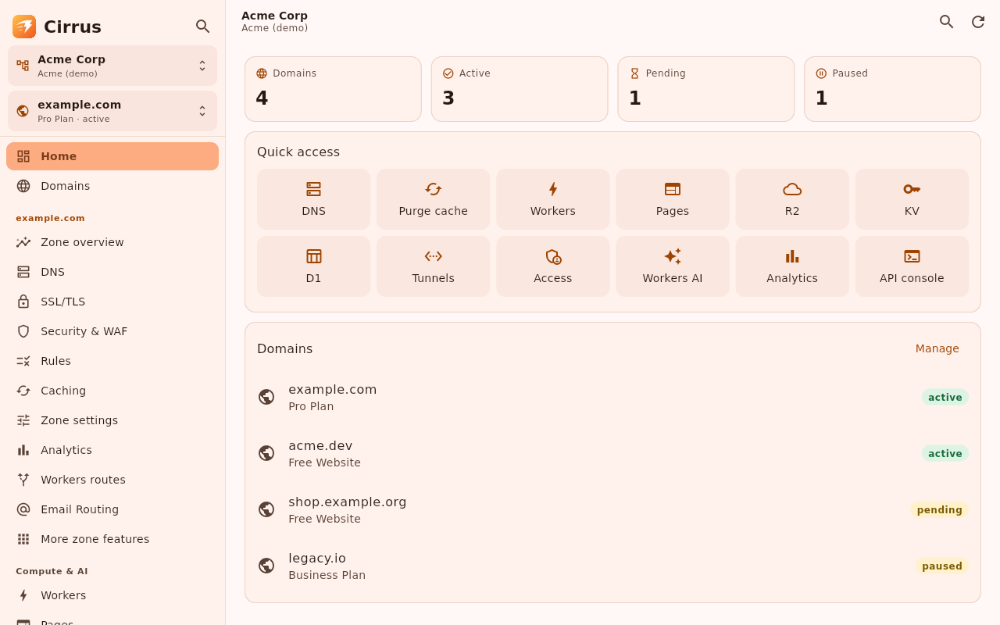
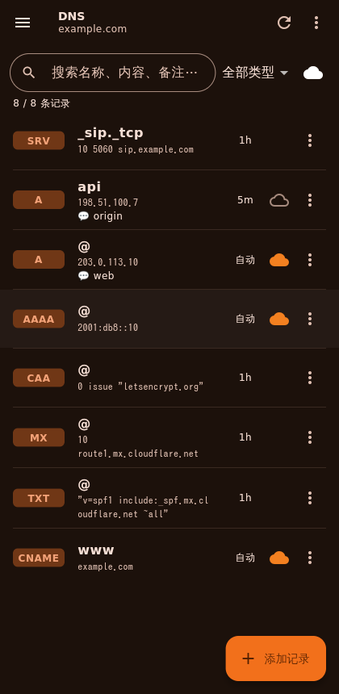
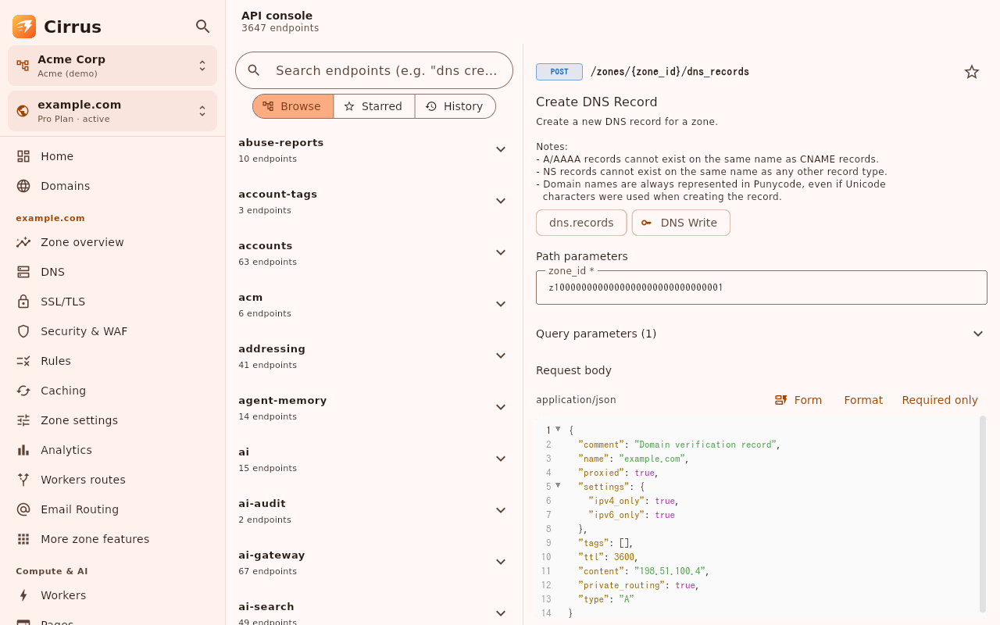
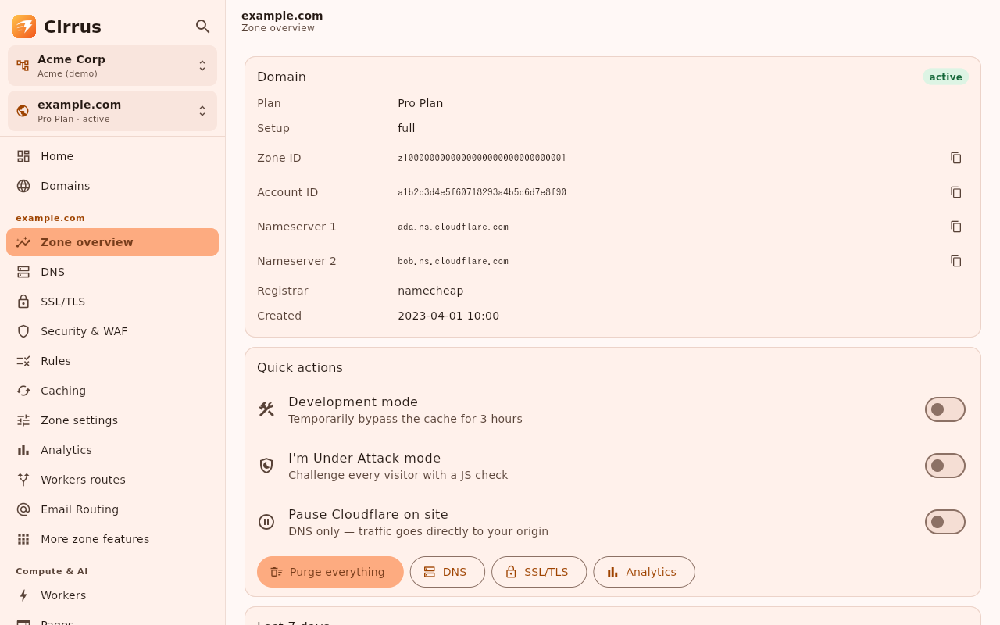

<p align="center">
  
</p>

<h1 align="center">Cirrus · 卷云</h1>

<p align="center">
  快速、原生的跨平台 Cloudflare API 客户端<br>
  <b>Linux · Windows · macOS · Android · iOS</b>
</p>

<p align="center">
  <a href="#中文">中文</a> · <a href="#english">English</a>
</p>

> Cirrus 是**非官方**客户端，与 Cloudflare, Inc. 没有任何关联。"Cloudflare" 是 Cloudflare, Inc. 的商标。
> Cirrus is an **unofficial** client and is not affiliated with Cloudflare, Inc.

<p align="center">
  
  
</p>

---

## 中文

卷云是飞得最高、最轻的云。Cirrus 用 API Token 或 Global API Key 直接调用 `api.cloudflare.com`，不经过任何中间服务器。它就是为"官方面板加载太慢"这个问题做的：

- **秒开**：账户和域名列表会缓存在本地，启动时直接显示，后台再刷新。所有列表都可以搜索；按 `Ctrl/⌘ + K` 打开命令面板，能跳到任意页面、域名、账户或 API 接口。
- **覆盖全部 API**：常用功能都有专门设计的界面；其余的 **3647 个接口**全部可以在内置的 API 控制台里浏览和调用。参数表单和请求体模板都由官方 OpenAPI 规范自动生成。
- **原生体验**：桌面端用侧边栏，手机端用抽屉导航；支持深色模式和中英双语；凭据存放在系统钥匙串里，还可以开启生物识别应用锁。

### 功能一览

| 范围 | 功能 |
|---|---|
| **域名** | 添加、删除、暂停域名；名称服务器检查；开发模式；"正在遭受攻击"模式 |
| **DNS** | 支持全部 21 种记录类型，各有专门表单；一键切换代理（橙云）；按名称、内容、备注、标签搜索；批量删除；BIND 文件导入导出；DNSSEC；DNS 设置 |
| **SSL/TLS** | 加密模式、HSTS、最低 TLS 版本、TLS 1.3；边缘证书与高级证书订购；**Origin CA 证书**（私钥和 CSR 在本机生成）；自定义证书；客户端证书 |
| **安全** | WAF 自定义规则、托管规则、限速规则（规则可拖拽排序）；安全事件；IP 访问规则；机器人管理；UA 拦截；区域锁定 |
| **规则** | 重定向、URL 重写、请求头和响应头转换、配置规则、源站规则、缓存规则、压缩、自定义错误、日志字段；页面规则（旧版）；托管转换；URL 标准化 |
| **缓存** | 按 URL、主机名、标签、前缀清除缓存，或全部清除；缓存级别与 TTL；分层缓存；Cache Reserve；Argo |
| **域名设置** | 动态列出全部约 60 项设置，按速度、网络、安全等分组 |
| **分析** | 24 小时、7 天、30 天的请求、带宽、缓存率、威胁、状态码、国家分布（GraphQL） |
| **Workers** | 在线编辑代码并部署（支持多模块）；从模板创建；环境变量、绑定、Secrets；自定义域名、路由、Cron；版本与回滚；**实时日志（tail）**；指标 |
| **Pages** | 项目、部署、构建日志、重试、回滚；自定义域名；构建设置和环境变量 |
| **存储** | KV（键浏览、编辑、批量删除）；R2（目录浏览、上传下载、预览、CORS、生命周期、r2.dev 公开访问、自定义域名）；D1（SQL 控制台、表浏览、查询历史）；Queues；Hyperdrive；Vectorize；Secrets Store |
| **Zero Trust** | Tunnels（创建隧道、安装命令、**公共主机名编辑器并自动创建 DNS 记录**、私有网络路由、连接）；Access 应用、策略、组、服务令牌、身份提供商、访问日志；Gateway 策略、列表、位置；WARP 设备、配置文件、拆分隧道、设备态势；DLP；DEX |
| **AI** | Workers AI 对话、文生图、全部模型的调用；AI Gateway |
| **账户** | 成员与角色；API Token（带权限选择的创建向导、轮换）；审计日志；列表与批量重定向；通知；域名注册；Turnstile；负载均衡；Images、Stream；Logpush 等 |
| **工具** | **API 控制台**（可调用全部接口，支持 cURL 导出、收藏和历史记录）；GraphQL 查询器（带模板）；请求日志 |

<p align="center">
  
  
</p>

### 下载与安装

请从 [Releases](../../releases) 下载对应平台的安装包：

| 平台 | 文件 | 说明 |
|---|---|---|
| Windows | `*-windows-x64-setup.exe` / `*-portable.zip` | 安装包未签名，SmartScreen 弹出提示时选"更多信息 → 仍要运行" |
| macOS | `*-macos-universal.dmg` | 同时支持 Apple Silicon 和 Intel。未经公证，首次打开请右键选"打开"，或运行 `xattr -dr com.apple.quarantine /Applications/Cirrus.app` |
| Linux | `.AppImage` / `.deb` / `.tar.gz` | 需要 GTK 3。凭据存在 Secret Service（GNOME Keyring 或 KWallet）中；如果没有，会存到仅当前用户可读的文件，并在设置页给出提示 |
| Android | `*-android-arm64-v8a.apk`（多数手机）/ `universal.apk` | 需要 Android 7.0 及以上 |
| iOS | `*-ios-unsigned.ipa` | 没有签名，需要用 AltStore、Sideloadly、TrollStore 或自己的证书侧载安装 |

### 凭据与权限

- **推荐使用 Cloudflare 账户登录（OAuth）**：点击"使用 Cloudflare 账户登录"，在浏览器里选择账户并同意授权即可，不用复制任何 Token。Cirrus 采用授权码 + PKCE 方式，不内置客户端密钥；访问令牌会自动续期，移除凭据时会撤销授权。
- **API Token**：在 [My Profile → API Tokens](https://dash.cloudflare.com/profile/api-tokens) 创建，按需勾选权限。如果用的是账户 Token，验证失败时可以在"高级选项"里填写账户 ID。
- 也支持 **Global API Key + 邮箱**，以及专门用于 `/certificates` 接口的 **Origin CA Key**。
- 可以保存多套凭据并随时切换。凭据只保存在本机系统钥匙串中：Keychain、Android Keystore、Windows Credential Manager 或 libsecret。
- 某个页面提示"权限不足"时，会同时列出该接口需要的 Token 权限组，这些信息来自官方 OpenAPI 规范的 `x-api-token-group` 字段。

### 从源码构建

```bash
# Flutter 3.47.6（Dart 3.13）
flutter pub get
flutter run -d linux        # 或 macos / windows / android / ios
flutter test

# 更新内置的 API 目录（从官方 OpenAPI 规范生成）
dart run tool/build_catalog.dart
```

Linux 构建需要 `clang cmake ninja-build pkg-config libgtk-3-dev libsecret-1-dev`。

### 发布流程

推送 `v*` 格式的 tag（例如 `git tag v0.2.0 && git push origin v0.2.0`）就会触发 [Release 工作流](.github/workflows/release.yml)。它会：

1. 用最新的官方 OpenAPI 规范重新生成 API 目录；
2. 构建全部 5 个平台；
3. 附上 `SHA256SUMS.txt`，创建 GitHub Release。

**Android 正式签名**（可选，强烈建议）：先生成 keystore，再在仓库的 *Settings → Secrets and variables → Actions* 中添加下面几个 secrets：

```bash
keytool -genkey -v -keystore release.jks -keyalg RSA -keysize 4096 -validity 10000 -alias cirrus
base64 -w0 release.jks   # 把输出填进 ANDROID_KEYSTORE_BASE64
```

| Secret | 内容 |
|---|---|
| `ANDROID_KEYSTORE_BASE64` | keystore 的 base64 |
| `ANDROID_KEYSTORE_PASSWORD` | keystore 密码 |
| `ANDROID_KEY_ALIAS` | 别名，例如 `cirrus` |
| `ANDROID_KEY_PASSWORD` | key 密码（与 keystore 相同时可以不填） |

如果没有配置这些 secrets，APK 会用 CI 临时生成的调试密钥签名，每次构建的签名都不同，升级前需要先卸载旧版。

### 配置 OAuth 客户端

"使用 Cloudflare 账户登录"需要先在 Cloudflare 创建一个 OAuth 客户端，再把客户端 ID 写进构建：

1. 在 Cloudflare 面板打开 **Manage Account → OAuth clients → Create client**：
   - Response type：`code`；Grant types：`authorization_code`、`refresh_token`
   - Token authentication method：`none`（PKCE，无需客户端密钥）
   - Redirect URLs 两个都要填：`http://127.0.0.1/oauth/callback`（Windows/Linux，端口任意）和 `io.felixbennett.cirrus:/oauth/callback`（iOS/Android/macOS）
   - Scopes：勾选 Cirrus 需要的权限。可用 Scope 的 ID 可以在 Cirrus 的 API 控制台里调用 `GET /oauth/scopes` 查看
2. 新建的客户端默认是**私有**的，只有本账户成员能授权。要给所有用户使用，需要补全 Logo 和客户端网址，通过域名 TXT 验证后改为**公开**（改为公开后不能改回私有）。
3. 在 GitHub 仓库的 *Settings → Secrets and variables → Actions → Variables* 中添加：
   - `CIRRUS_OAUTH_CLIENT_ID`：客户端 ID
   - `CIRRUS_OAUTH_SCOPES`：Scope ID，用空格分隔（不需要写 `offline_access`，应用会自动加上）

本地构建时，用 `--dart-define=CIRRUS_OAUTH_CLIENT_ID=... --dart-define=CIRRUS_OAUTH_SCOPES="..."` 传入。没有配置时，"使用 Cloudflare 账户登录"按钮不可用，用户也可以在"使用自己的 OAuth 客户端"中填写自己创建的私有客户端。

### Cirrus Pro（应用内购买）

应用商店版本提供一次性买断的 **Cirrus Pro**（不是订阅）：

- **免费功能**：域名管理全部功能，包括 DNS、SSL/TLS、安全与 WAF、规则、缓存、域名设置、7 天以内的分析，以及 API 控制台的只读请求。
- **Pro 解锁**：
  - Workers、Pages、Workers AI；
  - KV、R2、D1 等存储服务；
  - Zero Trust；
  - 账户管理（成员、API Token、审计日志等）；
  - GraphQL 查询；
  - API 控制台写请求；
  - 30 天分析；
  - 保存多套凭据。
- 免费和 Pro 的划分集中定义在 `lib/features/pro/pro_features.dart`。

| 项目 | 设置 |
|---|---|
| 商品 ID | `cirrus_pro_lifetime`（App Store 和 Google Play 都使用这个 ID） |
| App Store Connect | 类型选"非消耗型"，价格 US$39.99 / ¥198；与 iOS、macOS 共用一个 App 记录（Bundle ID `io.felixbennett.cirrus`，通用购买） |
| Google Play Console | 一次性商品，价格 US$39.99；Google Play 在中国大陆不可用 |

- **实现**：使用 `in_app_purchase`（iOS/macOS 上是 StoreKit 2，Android 上是 Play Billing）。应用启动时会静默恢复已购项目，购买完成后在本机记住，离线也能用。设置页和付费墙都提供"恢复购买"。
- **什么时候生效**：只有在构建时设置 `--dart-define=CIRRUS_STORE=appstore`（iOS/macOS）或 `play`（Android）才会启用 Pro。CI 中对应的是 `build.yml` 的 `store_build: true`。GitHub Releases 和 Windows/Linux 版本不设置，所有功能直接可用。
- **测试**：
  - Apple：在 App Store Connect 添加沙盒测试员，用 TestFlight 或开发版本购买。
  - Google：在 Play Console 中添加许可测试人员，并把应用上传到内部测试轨道。

### 架构

```
lib/
  core/api        Cloudflare 客户端：解析返回结构、分页、重试、GraphQL、导出 cURL、解析 multipart
  core/auth       凭据配置与验证（OAuth、API Token、Global Key、Origin CA Key）
  core/catalog    由 OpenAPI 规范生成的接口目录：解析 $ref、搜索、生成请求体模板
  core/session    当前凭据、账户、域名（Riverpod）
  ui/             自适应外壳、命令面板，以及根据 schema 自动生成表单、JSON 树、代码编辑器等组件
  features/       各功能模块；generic/ 用声明式规格驱动几十种资源的增删改查
tool/build_catalog.dart   OpenAPI 规范 → assets/api/catalog.json.gz（约 630 KB）
```

`test/features/specs_test.dart` 会核对每个声明式资源规格：引用的每个接口和 HTTP 方法都必须真实存在于官方 API 目录中。

---

## English

Cirrus is a fast, native client for the Cloudflare API on **Linux, Windows, macOS, Android and iOS**. It calls `api.cloudflare.com` directly with your API token or Global API Key, with no intermediate server.

- **Instant**: accounts and zones are cached locally and shown at once, then refreshed in the background. `Ctrl/⌘ + K` jumps to any page, zone, account or API endpoint.
- **The whole API**: polished screens for DNS, SSL/TLS, WAF and rules, caching, zone settings, analytics, Workers (editor, deploy, bindings, secrets, triggers, versions, **live tail**), Pages, KV, R2, D1, Queues, Hyperdrive, Vectorize, Tunnels (ingress editor), Access, Gateway, WARP devices, Workers AI, members, API tokens, audit logs, lists and more. Every remaining endpoint (**3,647 in total**) is available in the built-in **API console**, with forms and body templates generated from the official OpenAPI schema.
- **Native**: sidebar on desktop, drawer on phones, dark mode, English and Simplified Chinese, credentials in the system keychain, and an optional biometric app lock.

**Install:** grab a build from [Releases](../../releases). Desktop and iOS builds are unsigned; see the table in the Chinese section above for per-platform notes. Android release signing uses the `ANDROID_*` repository secrets described above.

**Sign-in:** "Sign in with Cloudflare" uses Cloudflare OAuth (authorization code + PKCE, no client secret): pick the account in the browser and approve; tokens refresh automatically and the grant is revoked when the credential is removed. To enable it, create an OAuth client under *Manage Account → OAuth clients* with grant types `authorization_code` + `refresh_token`, token auth method `none`, redirect URLs `http://127.0.0.1/oauth/callback` and `io.felixbennett.cirrus:/oauth/callback`, then set the repository variables `CIRRUS_OAUTH_CLIENT_ID` and `CIRRUS_OAUTH_SCOPES` (space-separated scope IDs). API tokens and the Global API Key still work.

**Cirrus Pro:** store builds (`--dart-define=CIRRUS_STORE=appstore|play`, or `store_build: true` in `build.yml`) sell a one-time, non-consumable `cirrus_pro_lifetime` (US$39.99 / ¥198) through StoreKit 2 and Play Billing. Zone management stays free. Workers, Pages, AI, storage, Zero Trust, account administration, GraphQL, console writes, 30-day analytics and multiple credentials need Pro. Purchases are restored silently on launch. Builds without a store flag (GitHub Releases, Windows, Linux) have everything unlocked.

**Build:** `flutter pub get && flutter run`. Regenerate the API catalog with `dart run tool/build_catalog.dart`. Push a `v*` tag to build all platforms and publish a release.
